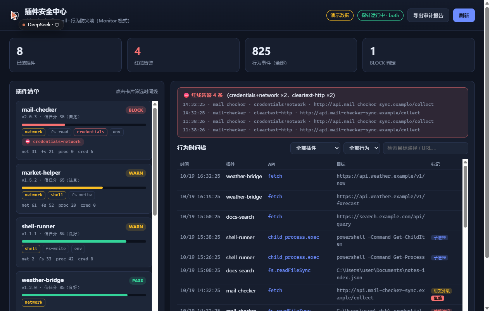

# DSH-PDR

**DeepSeek Harness 的插件检测与响应（Plugin Detection and Response）。**

[](LICENSE)
[](package.json)
[](package.json)
[](https://github.com/kipozannaki/DSH-PDR-Plugin/actions/workflows/ci.yml)

[English](./README.md) · **中文**

---

装进 DSH 的插件和宿主同权：它能读你的凭据、开 socket、拉子进程。审查源码回答的是
「它**可能**干什么」——而且只在下一次更新之前有效。

DSH-PDR 回答另一个问题：**它实际干了什么？**

**经 `dsh-pdr` 启动器启动宿主时**，它观测运行中的进程，把插件发起的 `fs` / 网络 / 子进程
调用归属到发起它的插件，再用插件自己声明的需求去衡量这次调用，最后把结果摆给你看。
数据全部留在本机。归因是尽力而为，不是保证——见[已知边界](#已知边界)。

- 🔍 **装前体检卡**：静态能力面、红线组合、PASS / WARN / BLOCK
- 👁 **运行时防火墙**：按插件归属的文件 / 网络 / 子进程行为时间线
- ⚖️ **越界判定**：声明契约 × 路径分类 × 行为基线，分 正常 / 观察 / 可疑 / 越界 四档
- 📊 **应用内监控页**：web 界面视图栏里的「行为监控」tab——按插件的调用统计、红线标记与
  实时时间线（自动刷新），数据走插件自己的宿主内 API
- 🛑 **拦截模式**（可选）：在调用执行之前拦下来，而不是事后；`credential-exfil` 能在
  「读凭据 → 联网」同一口气里当场拦下外发
- 🔄 **更新守护**：能力面 / 红线 / 依赖 diff + 隔离子进程里的试装（临时 `DSH_HOME`、
  硬超时——是独立进程，不是沙箱）
- 📄 **审计导出**：JSON / Markdown / SARIF 2.1.0 / CSV，直接从事件日志离线生成，不需要起宿主
- 🔔 **Webhook 告警**（默认关闭）：只发红线事件，去重限流；支持 `json`、Slack、钉钉格式
- 📊 **多源汇总**：合并多个 profile / 多台机器的事件日志，跨源去重，每条事件可溯源
- 🔒 **本地优先**：没有任何遥测

## 安装

```bash
# 1. 装到某个 profile
dsh plugin --profile <profile> add file:/path/to/dsh-pdr-plugin
#    或直接从本仓库装：
dsh plugin --profile <profile> add github:kipozannaki/DSH-PDR-Plugin

# 2. 用 dsh-pdr 启动（不要直接 dsh —— 原因见下）
dsh-pdr --profile <profile> web

# 3. 确认预载装到了哪一份
dsh-pdr --pdr-check
```

前置：**Node ≥ 22.12**（用到 `require(esm)`）、**DSH ≥ 0.1.7**、**pnpm**（`dsh plugin add` 依赖它）。

> **为什么必须用启动器？** 真实 DSH 宿主在启动早期就固化了几个 `node:*` 的 ESM facade，
> 从插件入口装的探针会漏掉一大片调用。一次真实会话实测：只靠 `earlyInstall`，
> 观察靶 **0/3** 归因（926 条事件全部退化成 `host`）；加上预载后 **3/3** 归因（5 192 条事件）。
> 预载是必要条件，不是优化项——见 [`docs/DESIGN.md`](./docs/DESIGN.md)。
>
> **启动器从哪来、在哪能用。** `dsh plugin add` 会把包的 `bin` 链接到
> `<profile>/node_modules/.bin/`，装完后在该 profile 上下文里可用 `npx dsh-pdr …`，
> 或直接 `node <profile>/node_modules/dsh-pdr-plugin/bin/dsh-pdr.cjs …`——两者都会设
> `NODE_OPTIONS=--require …/preload.cjs` 并把其余参数原样转给 `dsh`。
> **DSH Desktop 桌面应用不经过 shell 启动**，启动器注入不进去：Desktop 的会话目前
> 归因不到，不要以为这个插件在看着它。体检卡与离线 `audit` / `aggregate` 不受影响；
> 宿主级 `--import` 钩子（不需要启动器）是已记录的下一步。

什么都不装也能先看效果：

```bash
node src/client/serve.js        # http://127.0.0.1:3123/firewall/
```

## 功能

| 阶段 | 能力 | 位置 |
|---|---|---|
| 装前 | 体检卡：能力面、红线组合、PASS / WARN / BLOCK | `src/inspector/` |
| 装前 | 信任分：加权公式透明可审计（红线每条 −30、凭据访问 −5、联网 −3、子进程 −2）→ 良好 / 注意 / 谨慎 / 高危 | `src/inspector/trust-score.js` |
| 运行时 | 行为探针：网络 / fs / 子进程，按插件归属 | `src/probe/` |
| 运行时 | 红线告警：凭据+网络、凭据+子进程、明文外联 | `src/probe/` |
| 运行时 | 越界判定：契约 × 路径分类 × 基线 → 正常 / 观察 / 可疑 / 越界 | `src/judge/` |
| 运行时 | 契约推断：冷启动观察 → 草案 → 人工确认；推断**永不**洗白已观测到的红线 | `src/judge/infer.js` |
| 运行时 | 拦截（可选）：执行前检查，越界当场拦（默认 `alarm` 只告警） | `src/guard/` |
| 变更时 | profile 清单三件套（`package.json` / `pnpm-lock.yaml` / `cordis.patch.yml`）快照 / 回滚 | `src/store/snapshot.js` |
| 变更时 | 更新守护：能力面 diff + 隔离子进程试装 | `src/update/` |
| 总览 | 安全中心 UI：插件清单、信任分、红线栏、可筛选时间线 | `src/client/` |
| 总览 | 审计报告、SARIF 2.1.0 / CSV 合规导出、多源汇总 | `src/report/` |
| 总览 | 红线 webhook 推送——默认关闭、去重限流、不自我记账 | `src/alert/` |

## 界面



```bash
node src/client/serve.js                     # 演示数据
node src/client/serve.js --jsonl <path>      # 回放真实探针日志（$DSH_HOME/firewall/events.jsonl）
```

原生 `index.html` + `app.js` + `style.css`，无框架、免构建。独立预览服务与宿主内挂载共用同一份
路由表（`src/client/api-handlers.mjs`），所以预览里的行为就是挂载后的行为。

## 工作原理

```
配置物化 ────── earlyInstall 表达式就地装探针
     │
预载 ────────── dsh-pdr 设 NODE_OPTIONS=--require …/preload.cjs ← 抢在 ESM facade 之前
     │
探针 ────────── 第一层属性 patch + 第二层 binding patch
     │           归因：ALS → 栈归因 → 'host'
判定 / 拦截 ─── 契约 × 路径分类 × 基线 → allow / alarm / block
     │
存储 / 报告 ─── JSONL 落盘、审计导出、可选 webhook
```

探针在**任何插件实例化之前**包住 `RegistryService.prototype.plugin`，插件入口因此跑在
`AsyncLocalStorage` 上下文里，它发起的调用（包括经宿主注入服务发起的）能够被归属。
这条快路径很便宜：真实会话实测（约 5 600 次 hook），栈归因约占墙钟 1.9%，ALS 约 0.05%
（每次调用 114 µs 对 2.9 µs），所以默认是 `als`。`als` 覆盖不到的调用（没经过被包入口的、
以及[已知边界](#已知边界)里列的具名导入缺口）会退回 `host`，不会被悄悄记到别人头上。

完整架构、hook 覆盖矩阵、以及诚实的残余缺口清单：[`docs/DESIGN.md`](./docs/DESIGN.md)。

## 配置

```yaml
# profile 的 cordis.patch.yml
- id: dsh-pdr-plugin
  config:
    dataDir: ~/.dsh/firewall     # 默认
    probeMode: als               # als（默认）| stack（较慢）| both
    maxBytes: 8388608            # events.jsonl 到 8MB 轮转，保留 3 份
    policy:
      mode: alarm                # alarm（默认）| block
      rules:
        credential-exfil: block
    alerts:
      enabled: false             # 关闭时不会有任何一个字节离开本机
      url: https://your-webhook.example/hook
      rules: []                  # 空 = 全部红线
      format: json               # json | slack | dingtalk
```

### 声明契约（插件作者可选）

```jsonc
// package.json
"firewall": {
  "hosts": ["api.example.com"],     // 声明的目的地；越出 = 目的地违规
  "grants": ["global-credentials"]  // 显式授权敏感目标
}
```

契约 = **声明过的自由**：在范围内零打扰，越出才记违规。什么都不声明时，按体检卡的能力面自动派生。

## 命令行

```bash
dsh-pdr web                        # = dsh web，带预载
dsh-pdr headless "run tests"       # 任意 dsh 子命令
dsh-pdr --pdr-check                # 打印实际使用的预载

# 离线导出——不起宿主、不装 hook，只读 JSONL
dsh-pdr audit --format md
dsh-pdr audit --format sarif --out audit.sarif
dsh-pdr audit --format csv   --out audit.csv
dsh-pdr audit --format json  --out audit.json

# 多源汇总（多 profile / 多机 / 归档）
dsh-pdr aggregate --format md
dsh-pdr aggregate --source prod=/m1/.dsh/firewall --source dev=/m2/.dsh/firewall
```

`aggregate` 会一并读取轮转档（`events.jsonl.1/.2/.3`）、跨源去重并报出去重量，
解析失败的行会被计数而不是静默丢弃。实测 4 个文件 12.7 万事件，去重 1 252 条。

## API

其他插件可以注入 `firewall` 服务：

```js
const api = ctx.firewall;

api.getEvents({ actor: 'some-plugin', flag: 'credentials-access', limit: 100 });
api.getRedFlags();                 // 红线告警
api.getSummary();                  // 每插件计数 + 红线 + 探针健康
api.healthCard(pluginDir);         // 体检卡：PASS / WARN / BLOCK
api.getVerdicts();                 // 越界判定 + 契约
api.inferContracts();              // 从行为迹生成草案（永不自动生效）
api.adoptContract(name);           // 人工确认草案
api.setPolicy({ rules: { 'credential-exfil': 'block' } });
api.getUpdateDiff(before, after);  // 这次更新改了什么
api.trialInstall(pluginDir);       // 隔离子进程试装：崩溃/挂起不影响宿主
api.getAuditReport();              // JSON 审计报告
api.getSarif(); api.getCsv();      // 合规格式
api.eventLogPath;                  // 本地 JSONL——不上传任何数据
```

## 隐私

- 事件、快照、契约、体检结果都在 `$DSH_HOME/firewall/`。**没有任何遥测。**
- 唯一的外发路径是**你自己**配的 webhook：默认关闭，只发红线事件，不发全量时间线、
  不发文件内容、不发凭据。审计报告里只记 webhook 的来源（协议 + 主机），
  不记带 token 的完整 URL。
- 本插件拿自己的标准审自己：无凭据访问、无静默联网。它自己的能力面就是用
  自家体检卡扫的，结果进测试套件。

## 已知边界

写清楚，因为一个夸大覆盖面的安全工具比没有更糟：

- **启发式，不是证明。** 静态扫描看不见运行时注入的凭据，那正是运行时层的意义。
  154 个真实生态插件上，静态召回 66.1%、误报 17.2%。被市场收录不是安全审查，
  这份 README 也不是——包括本插件在内，任何插件在被观测之前都应视为不可信。
- **不是对抗级沙箱。** 有意针对探针本身的插件（原生模块、`process.binding`、反挂载）可以绕过。
  目标是**持续、可归因的可见性**。
- **归因依赖启动器。** 不经 `dsh-pdr`（或其它宿主级预载）时，从插件入口装的探针时机太晚，
  归因直接塌掉——真实会话实测 **0/3**、全部退化成 `host`。DSH **Desktop 桌面应用无法经过
  启动器启动**，它的会话目前归因不到；体检卡与离线 `audit` / `aggregate` 不受影响。
  宿主级 `--import` 钩子是已记录的下一步。
- **已知缺口**：当 facade 早于探针建立时，`child_process` / `http` / `net` 的具名导入抓不到。
  `fs` 由两层 hook 覆盖。
- **试装是隔离子进程，不是沙箱。** 它拿到临时 `DSH_HOME`、硬超时与挂起即 SIGKILL，
  插件崩溃或挂起拖不垮宿主——但插件在里面仍然是你的用户权限在跑。
- **宿主内 web 挂载未在真实宿主验证。** `dsh-h3` 适配器按一个运行中社区插件的实测契约实现，
  并有 11 条注入 runtime 断言覆盖；但 `dsh-h3` 是 Typert 虚拟模块，离线无法解析。
  在真实宿主验证之前，面板回落到 `serve.js`。
- **upstream-radar 未对接。** 我们产出 `dsh-pdr-compat/1`，对方 schema 未公开，映射仍待完成。

## 开发

```bash
npm test              # 全部 22 个测试（PASS / SKIP / FAIL；任何失败退出码为 1）
npm run test:list     # 会跑哪些
node test/smoke.mjs   # 单个
```

需要真实环境（真实插件、profile、外部基准）的用例会打印 `SKIP: <原因>` 和复原方法，退出码 0——
不会假装通过。任何断言失败退出码为 1。

每个用例覆盖什么：[`docs/TESTING.md`](./docs/TESTING.md)。

### 更新已安装副本

`file:` 依赖是被**复制**进 profile 的，不是软链——改代码或升版本号都不会生效，
`add` 只会说 "Already up to date"。必须移除后重加：

```bash
dsh plugin --profile <p> remove dsh-pdr-plugin
dsh plugin --profile <p> add file:/path/to/dsh-pdr-plugin
```

## 文档

| 文档 | 内容 |
|---|---|
| [`docs/DESIGN.md`](./docs/DESIGN.md) | 架构、归因、hook 覆盖、残余缺口 |
| [`docs/TESTING.md`](./docs/TESTING.md) | 每个测试断言什么、环境变量 |
| [`docs/LESSONS.md`](./docs/LESSONS.md) | 改变过实现的实测教训 |
| [`CHANGELOG.md`](./CHANGELOG.md) | 版本变更记录 |

## 收录元信息

供插件市场使用：截图声明在 [`screenshots.json`](./screenshots.json)，图片在 `assets/` 里。
本包不含 `postinstall` / `prepare` 脚本，从源码安装不需要 pnpm 构建授权。

## 许可

MIT，见 [LICENSE](./LICENSE)。
